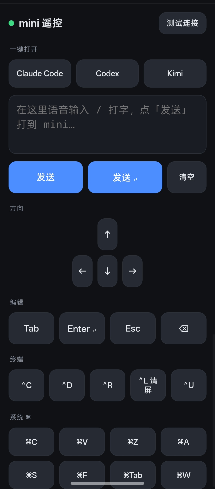

# phone-remote

**English** | [简体中文](README_CN.md)

Turn a phone into a wireless keyboard + shortcut pad + CLI launcher for a Mac.

Open a web page on the phone, type or **dictate** into the text box (using the
phone's own keyboard/voice input), and tap buttons for arrows, Tab, Ctrl+C, ⌘
combos. Commands reach the Mac over your LAN/Tailscale and are injected as real
keyboard events into whatever window is frontmost.

There's also a row of **one-tap launchers** at the top: tap one and a fresh
Terminal window opens on the Mac running Claude Code / Codex / Kimi, in the
working directory you picked, brought to the front for you. Together with the
text box below it the loop is **launch the tool → dictate the prompt → tap
"send ↵"** — without touching the Mac's keyboard.

Those three are just what I happen to use. **Put whatever CLI you like there** —
aider, gemini, opencode, your own script, even `htop` or `lazygit`. Anything that
runs as one shell command works; it's one row in the `APPS` table (see
"Customizing buttons" below).

<p align="center">
  
  <br>
  <em>Running as a home-screen web app. Buttons are plain HTML — the launcher row
  takes whatever CLI you like, one row in a whitelist and one button in the page.</em>
</p>

## Why

When you drive a headless/remote Mac through a remote-desktop tool, **voice
dictation doesn't reach it**: remote software forwards physical keypresses fine
but mangles IME composition, so dictated text (especially CJK) never lands.

phone-remote sidesteps that by injecting **locally on the target Mac** instead of
forwarding input across the remote session. Use the remote desktop to *see* the
screen and the phone to *type* — two separate paths. Chinese text and modifier
combos both work.

No app to install on the phone: it's a web page you "Add to Home Screen", so the
same setup works on iPhone and Android side by side.

## Install

Requires macOS 13+, Node.js on your `PATH`, and Xcode Command Line Tools
(`install.sh` compiles the wrapper with `clang` and signs it with `codesign`;
install them with `xcode-select --install`). The installer and the keystroke injection (`osascript`) are macOS-only, so there is nothing useful to run on Linux.

```bash
git clone https://github.com/AliceLJY/phone-remote.git ~/Projects/phone-remote
cd ~/Projects/phone-remote
./install.sh
```

`install.sh` builds a small signed `.app` wrapper into `~/Applications`, installs
a LaunchAgent (starts at login, restarts on crash), and starts the service.
Zero npm dependencies — Node's standard library only.

To run it in the foreground instead:

```bash
node server.js                 # listens on 127.0.0.1 only: the phone can't reach it yet
HOST=0.0.0.0 node server.js    # reachable from the LAN / Tailscale (see Security)
```

Both print the tokenized phone URL. The LaunchAgent that `install.sh` writes
sets no `HOST`, so the background service also listens on `127.0.0.1` only.
To reach it from the phone without opening the port to your LAN, forward it
over Tailscale (this is how the author runs it):

```bash
tailscale serve --bg --tcp 8787 tcp://127.0.0.1:8787
```

The phone then uses the Tailscale URL from the startup log. The `.local` LAN
address it also prints only works if you start the server with `HOST=0.0.0.0`.

### One manual step: Accessibility

Synthesizing keystrokes requires Accessibility permission, which macOS grants
per executable:

> System Settings → Privacy & Security → Accessibility → **+** → Applications →
> **Phone Remote** → toggle on

Then `launchctl kickstart -k gui/$(id -u)/com.example.phone-remote` (the default
label; use your own if you ran `install.sh` with `PR_LABEL=...`). Until this is granted,
`/type` and `/key` return a `not allowed to send keystrokes (1002)` error.

**Why the .app wrapper**: macOS grants Accessibility per executable. If launchd
pointed straight at `/opt/homebrew/bin/node`, that hidden path would be hard to
pick in the permission panel, and a Homebrew node upgrade would move the Cellar
path and silently invalidate the grant. A signed .app keeps the identity stable
and easy to spot in the list.

## Use it from the phone

The startup log (`~/ops-logs/phone-remote/stdout.log`) prints a tokenized URL:

```
http://100.x.y.z:8787/?t=<token>
```

The IP comes from `tailscale ip -4`; without Tailscale it prints a literal
`<本机IP>` ("this machine's IP") placeholder, so put in the Mac's LAN IP yourself.

Open it on the phone (over Tailscale, or `<your-mac>.local:8787` on the same
LAN), then **Add to Home Screen** — it becomes a full-screen app that carries
its own token, indistinguishable from a native one.

Three taps: pick a CLI from **one-tap launch** at the top (the new window brings
itself to the front), dictate into the text box, tap **send ↵**. For the next
turn just repeat the last two.

When you skip the launcher (say you already opened a terminal by hand), make
sure the Mac's frontmost window is where you want the text to land — keys go to
whatever is in front.

## Customizing buttons

**This section is the point: that row is meant to be edited.** Buttons are plain
HTML in `index.html`:

```html
<button onclick="key('ctrl-r')">^R</button>
```

`key()` takes any name from the `KEYS` whitelist in `server.js`; add a row there
to support a new one (`{ code: <AppleScript key code> }` or
`{ char: "x", mods: ["cmd","shift"] }`).

The launcher buttons work the same way, against the `APPS` whitelist in
`server.js`:

```js
const APPS = {
  cc: { label: "Claude Code", cmd: "claude" },
  // add a row per tool; the command string lives here, not in the request
};
```

```html
<button class="sm" onclick="launch('cc')">Claude Code</button>
```

`cmd` is just a shell command — another AI CLI, your own script, a TUI like
`lazygit`, whatever. Write the full path if it isn't on PATH (that's what the
Kimi row does).

New terminals open in your home directory by default. Point them somewhere else
with the `LAUNCH_CWD` environment variable on the service.

## Security

- Binds to `127.0.0.1` by default — only the Mac itself can reach it. To use it
  from your phone, set `HOST=0.0.0.0` (or your Tailscale IP) explicitly; do
  **not** port-forward this to the internet. Once opened up, anything that can
  reach the port and holds the token owns your keyboard.
- Every injection endpoint checks a token stored in `.token` (gitignored,
  mode 600, generated on first run). Requests without it get a 401.
- User input is never concatenated into a shell or AppleScript command: text is
  passed via a temp file and read with `read POSIX file … as «class utf8»`,
  shortcuts go through a fixed whitelist. No injection surface.
- The launcher follows the same whitelist rule: the client only ever sends a key
  name like `cc` / `codex` / `kimi`, and the command string that actually runs is
  hardcoded in the `APPS` table. **Not one character from the request body
  reaches the executed script.** Unknown names get a 400 and open no window.

## Notes / limitations

- Text injection goes through the clipboard (temp file → clipboard → ⌘V), so it
  **overwrites the Mac's current clipboard**.
- `pbcopy` is deliberately unused: in a non-Aqua/background session it silently
  fails to reach the GUI pasteboard (writes appear to succeed, `pbpaste` reads
  back empty). `osascript`'s `the clipboard` goes through AppKit and works.
- Keys land in the frontmost window — if another app steals focus, they go there.
- The launcher uses `open -a Terminal` (LaunchServices — no extra Automation
  grant needed). Raising the window is done by the launch script itself, not by
  the service: this service is started by launchd and has no UI, so the system
  won't let it bring another app forward (windows it opens stay in the
  background — verified). The script, being Terminal's own child, can.
- When the CLI exits, so does the window. Tap the button again for a new one —
  keeping the shell alive afterwards would need another interactive-shell layer,
  which isn't worth it.

MIT licensed.
